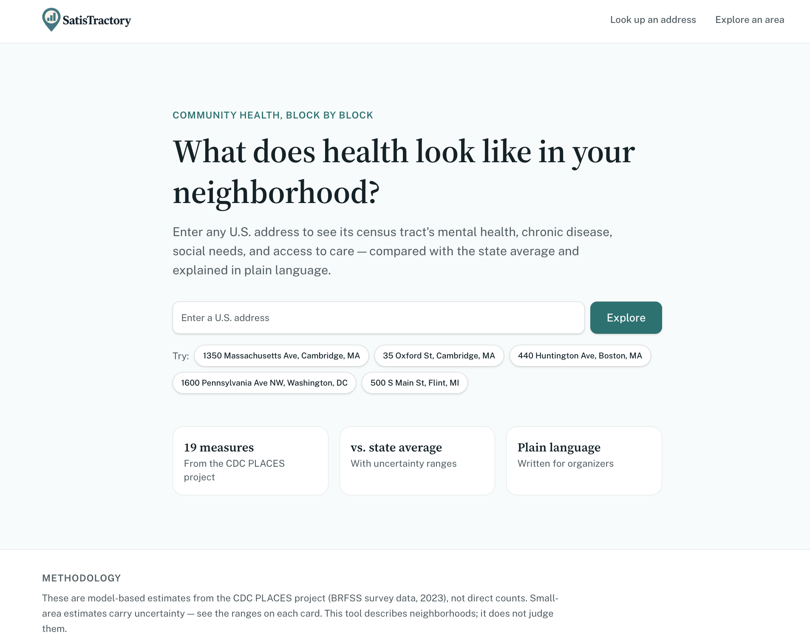
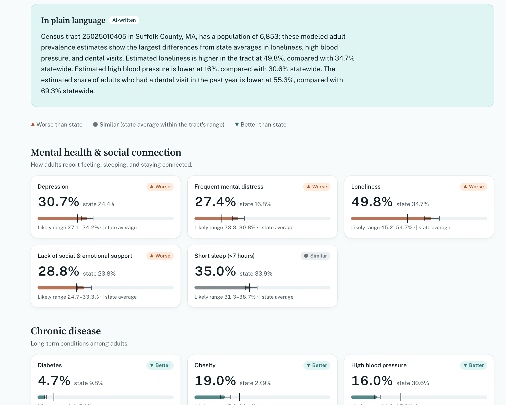
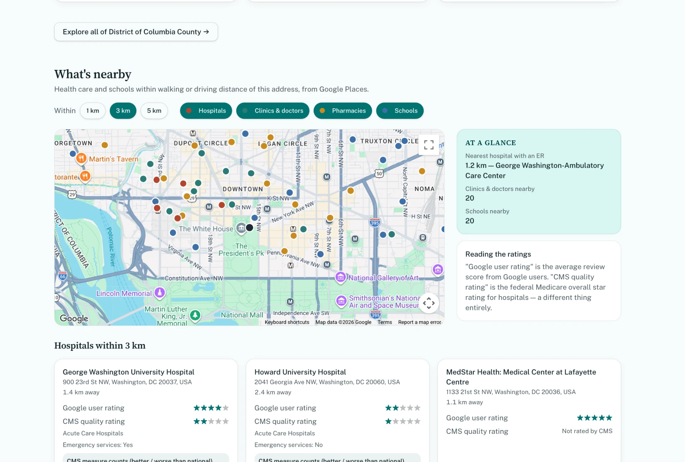
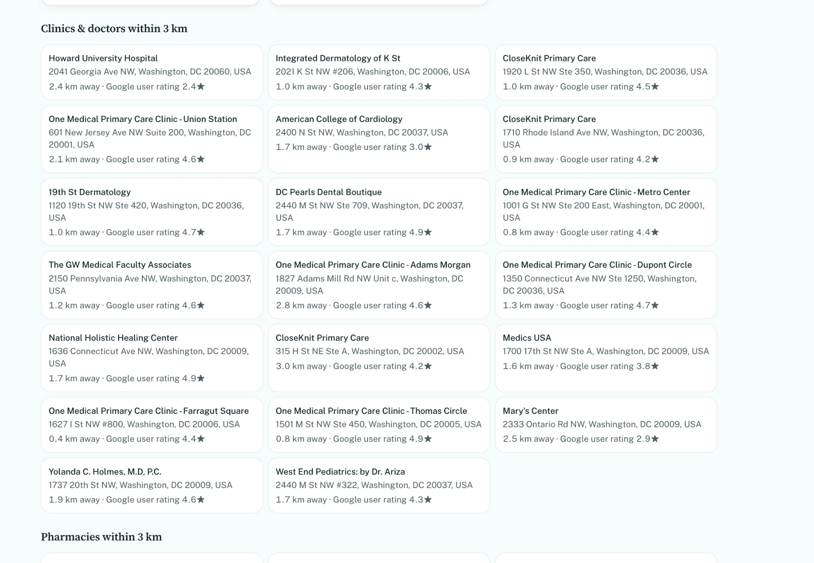
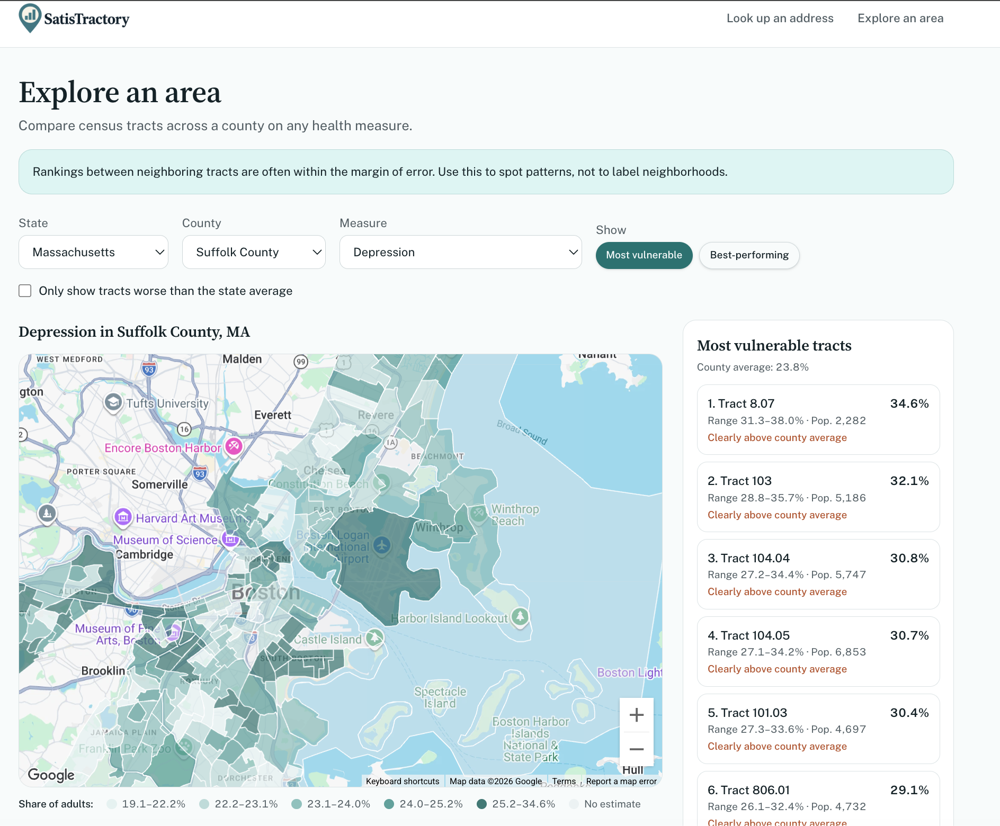

<div align="center">


### Your neighborhood's health, in plain language.

**🥇 1st place at the Lovable Hackathon x Startup Trek (November 2026)**

[Live app](https://satistractory1.lovable.app/) · [Walkthrough](#try-it-in-60-seconds) · [How we handle uncertainty](#reading-the-numbers-honestly) · [How it works](#how-it-works) · [Team](#the-team)


</div>

<p align="center">
  
</p>

## Why we built this

Back Bay and Roxbury are about ten minutes apart by car in Boston. In one Back Bay census tract, life expectancy is **92**. In one Roxbury tract, it's **69** ([Boston Public Health Commission, 2025](https://www.boston.gov/sites/default/files/file/2025/02/Live%20Long%20and%20Well%20Report_Final_Feb2025.pdf)). Two miles, twenty-three years.

Most of that gap isn't about genes or personal choices. It's about place: whether there's a grocery store nearby, whether you can get to a doctor, whether you have someone to call when things get hard. As public health researchers like to say, **your ZIP code can say more about your health than your genetic code.**

The data to show this already exists. The CDC's PLACES project publishes estimates for dozens of health measures across about **79,000 U.S. census tracts**. The problem is that it sits in government data portals behind FIPS codes and measure IDs. Residents don't know what their neighborhood is at risk for, and decision-makers don't have a quick way to see where help is needed most. Public tools are disappearing too: the EPA took EJScreen offline in early 2025.

So we asked a simple question: **what if anyone could type an address and understand their neighborhood's health in plain language?**

That's SatisTractory.

## Who it's for

- 🏠 **Residents and homeowners** who want to know what their block is at higher (or lower) risk for, compared with the rest of their state.
- 🤝 **Community organizers** looking for where outreach, food programs, or mental health support would matter most.
- 🏛️ **Planners and policymakers** who need a county-wide view that ranks tracts on any measure, with the uncertainty shown instead of hidden.

## Try it in 60 seconds

This is the same path we walked the judges through. Both addresses are one-click buttons on the home page.

1. **Start with Harvard.** Search `35 Oxford St, Cambridge, MA`. The tract shows *lower* chronic disease than the Massachusetts average, but *higher* loneliness.
2. **Then Northeastern.** Search `440 Huntington Ave, Boston, MA`. Depression and frequent mental distress both come in above the state average.
3. **Scroll to "What's nearby."** See hospitals, clinics, pharmacies, and schools within 1, 3, or 5 km.
4. **Open "Explore an area."** Pick Suffolk County, MA and any measure to see which tracts carry the heaviest burden.

## What you can do

### Get a neighborhood report

Type any U.S. address. SatisTractory finds its census tract and shows **19 health measures** in four groups. Each card gives you the tract's value, the state average, a likely range (the 95% confidence interval), and a simple *worse / similar / better* label.

At the top, a short **AI-written summary** explains the biggest differences in plain language. It's written on the server from numbers the server looks up itself, so nobody can tamper with what it says. It stays neutral: no blame, no guesses about causes, and no medical advice.

<p align="center"></p>

<details>
<summary><b>See all 19 measures</b></summary>

| Group | Measures |
|---|---|
| **Mental health & social connection** | Depression · Frequent mental distress · Loneliness · Lack of social & emotional support · Short sleep |
| **Chronic disease** | Diabetes · Obesity · High blood pressure · Current asthma · COPD · Coronary heart disease |
| **Social needs** | Food insecurity · Housing insecurity · Lack of reliable transportation · Utility shut-off threat · SNAP receipt |
| **Access to care** | No health insurance (ages 18–64) · Routine checkup · Dental visit |

</details>

### See what care is nearby

The report also maps hospitals, clinics and doctors, pharmacies, and schools within 1, 3, or 5 km. An "At a glance" panel shows the nearest hospital with an emergency room and how many clinics and schools are close by.

Hospital cards show **Google user ratings** and **CMS federal quality ratings** side by side, clearly labeled. They measure different things: a hospital can be popular online and still score poorly on safety, mortality, and readmissions.

<p align="center"></p>

<details>
<summary><b>See the clinic and doctor list</b></summary>
<p align="center"></p>
</details>

### Explore a whole county

Choose a state, a county, and a measure. You'll get a shaded map of every tract, a hover tooltip, and a ranked list of the most vulnerable or best-performing tracts. You can also show only tracts that are worse than the state average. Click any tract to open its full report.

<p align="center"></p>

## Reading the numbers honestly

Estimates for small areas are noisy, and neighboring tracts are often statistically the same. Ranking them by raw numbers can turn noise into headlines and stigmatize communities. So we built every comparison around the uncertainty:

- **Labels need real evidence.** A measure is only *worse* or *better* when the state average falls **outside** the tract's 95% range. Otherwise it's *similar*.
- **Flags are strict.** In the Explorer, a tract is marked *clearly above county average* only when its **entire** range sits above the county average.
- **Each measure knows which way is good.** More routine checkups is better; more uninsured adults is worse.
- **Shading is fair.** Map colors use five equal-sized groups (quantiles) worked out for that county and measure.
- **The caveats stay on screen.** The Explorer reminds you that close rankings are often within the margin of error, and every page explains these are estimates, not counts.

These rules are covered by unit tests in `src/test/health-compare.test.ts` and `src/test/explore.test.ts`.

## How it works

```text
 Browser (React 19 + TanStack Router)
    │   only talks to our own server functions, never to outside APIs
    ▼
 Server functions (TanStack Start)
    ├─ U.S. Census Geocoder ....... address → census tract
    ├─ Census TIGERweb ............ tract boundaries for the Explorer map
    ├─ CDC PLACES ................. tract estimates + state averages
    ├─ Google Places .............. nearby hospitals, clinics, pharmacies, schools
    └─ Lovable AI Gateway ......... plain-language summary
    │
    ▼
 Postgres (Lovable Cloud)
    caches for summaries, state averages, tract shapes, nearby places (7 days),
    plus a stored copy of CMS hospital ratings
```

A few decisions worth knowing about:

- **Nothing sensitive runs in the browser.** Every outside data call and AI call happens on the server, and the cache tables are server-only.
- **CMS ratings are a stored copy.** The CMS data portal blocks requests from serverless hosts, so we keep our own copy of the *Hospital General Information* dataset (about 5,400 hospitals). Hospitals are matched by ZIP code plus a fuzzy name match. If there's no confident match, the card says "Not rated by CMS" instead of guessing.
- **Caching keeps it fast and cheap.** Looking up the same tract, county, or radius again comes straight from the database.

**Tech stack:** TanStack Start v1 (React 19, Vite 7) · TypeScript · Tailwind CSS v4 · Postgres on Lovable Cloud · Google Maps JavaScript API + Places API (New) · Lovable AI Gateway · Vitest

## Data sources

| Source | What we use it for |
|---|---|
| [CDC PLACES: Local Data for Better Health](https://data.cdc.gov/500-Cities-Places/PLACES-Local-Data-for-Better-Health-Census-Tract-D/cwsq-ngmh/about_data) (census tract data, 2025 release, 2023 survey data) | Every health estimate and state average |
| [U.S. Census Geocoder](https://geocoding.geo.census.gov/geocoder/) | Turning an address into a census tract |
| [Census TIGERweb](https://tigerweb.geo.census.gov/) | 2020 census tract boundaries |
| [CMS Hospital General Information](https://data.cms.gov/provider-data/dataset/xubh-q36u) | Hospital star ratings and emergency services |
| [Google Maps Platform](https://developers.google.com/maps) | Maps and nearby places |

## Run it locally

You'll need [Node.js](https://nodejs.org/) 20 or newer.

```sh
git clone https://github.com/arndiddi/SatisTractory.git
cd SatisTractory
npm install
npm run dev     # opens the app at http://localhost:8080
npm test        # runs the unit tests
```
If `npm install` gives you an error, install [Bun](https://bun.sh) and run `bun install` instead, then continue with `npm run dev`.

The address lookup and CDC data work without any keys. The AI summary, maps, and nearby places need a few server-side credentials (an AI provider and Google Maps Platform) plus a Postgres database for the caches. On Lovable, Lovable Cloud and the Google Maps connector take care of all of that.

## Known limits

- **These are estimates, not counts.** PLACES values are modeled from survey data and are less certain in small tracts.
- **Rates aren't age-adjusted.** Tracts full of students, like the ones around Harvard and Northeastern, show low chronic disease mostly because the people living there are young.
- **It shows where, not why.** The app describes gaps; it doesn't explain their causes.
- **The state average is a simple average of tracts.** It isn't weighted by population.
- **Hospital matching is a best guess.** If we can't match a hospital confidently, we show "Not rated by CMS" rather than risk a wrong rating.
- **The map only loads on approved websites.** Everywhere else, the rest of the report still works.

## What's next

Ideas from our brainstorm that didn't make the hackathon cut:

- [ ] Compare two addresses side by side
- [ ] Food access data from the USDA Food Access Research Atlas
- [ ] Air quality from OpenAQ and heat alerts from the National Weather Service
- [ ] Trends over time across PLACES releases, and how local policy changes line up with them
- [ ] More neighborhood context, like home prices
- [ ] Age-adjusted comparisons, so student-heavy tracts compare fairly

## The team

SatisTractory was built at the **Lovable Hackathon x Startup Trek**, where it won **🥇 1st place**.

- **Arnav Diddi**
- **Dong Hyuk Shin**
- **Jonathon Tseng**
- **Catherine Li**
- **Franco Miguel**
- **Zach Derhake**

Designed and built with [Lovable](https://lovable.dev).

---

<div align="center">
<sub><b>Where you live shouldn't decide how long you live.</b> SatisTractory helps people see where it does, so they can start to change it.<br/>It describes neighborhoods; it doesn't judge them. Not medical advice.</sub>
</div>
